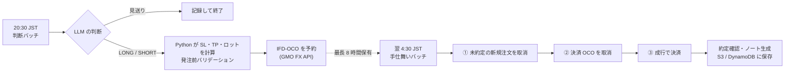
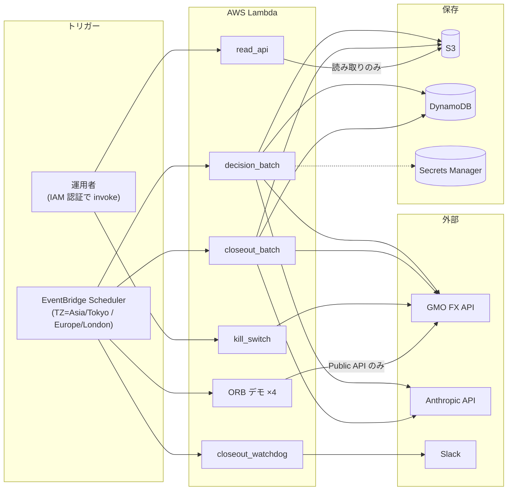
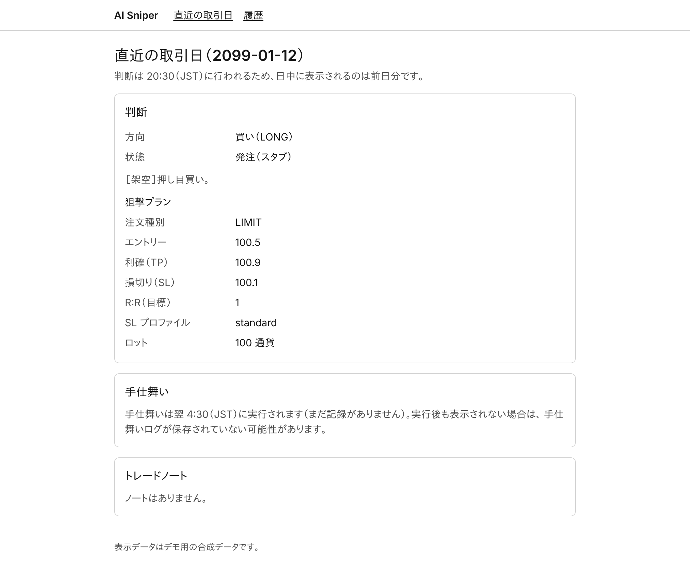
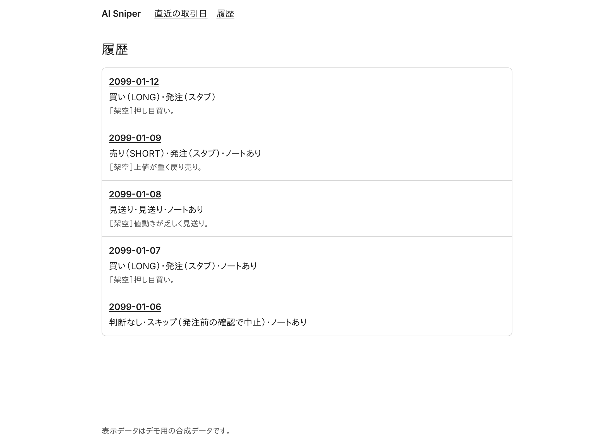
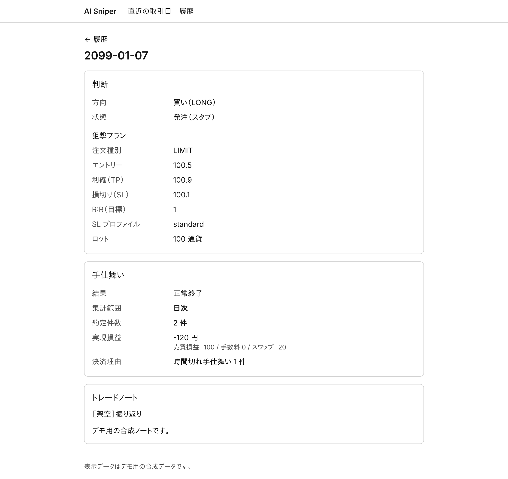

# AI Sniper System

**LLM の判断と Python の決定論的なリスク管理を組み合わせた、完全サーバーレスの FX 自動売買システム**（個人開発）。

平日の夜に LLM（Claude）が USD/JPY の売買方針を決め、損切り・利確・ロットは Python が計算して、
GMO コイン 外国為替FX API に IFD-OCO 注文を予約します。翌朝 4:30 には残った建玉を決まった順序で手仕舞いし、
取引の振り返りノートを残します。AWS Lambda + Terraform で構築し、**2026 年 8 月から実際の口座で取引しています**（最小ロット）。

> [!NOTE]
> このリポジトリは、非公開の開発リポジトリから**ポートフォリオ用に切り出した公開版**です。
> 運用記録や API の実レスポンスなど、一部の資料は含めていません（[公開版について](#公開版について)）。

**ダッシュボードのデモ:** <https://ai-sniper-demo.vercel.app>（合成データのみ・[ダッシュボード](#ダッシュボード)）

---

## 数字で見るプロジェクト

| 項目 | 規模 |
|---|---|
| 開発期間 | 2026-06 〜（個人開発・稼働中） |
| コミット / マージした PR | 約 750 / 約 210 |
| 本体コード | Python 約 16,100 行（`backend/src`）・TypeScript 約 1,600 行（`dashboard/`） |
| テストコード | Python 約 30,700 行・**2,000 件以上**・カバレッジ **91%**。ダッシュボードは Vitest 約 150 件・Playwright 40 件 |
| インフラ（Terraform） | 約 2,100 行・Lambda 10 関数・EventBridge Scheduler 9 本 |
| 実運用 | 2026-08 から実際の口座で取引（最小ロット 100 通貨） |

## 技術スタック

| 分類 | 使用技術 |
|---|---|
| 言語 | Python 3.11（型注釈必須・mypy）、TypeScript |
| AI | Anthropic API（Claude）: 売買判断・取引ノートの生成 |
| AWS | Lambda / EventBridge Scheduler / S3 / DynamoDB / Secrets Manager + KMS / CloudWatch / SNS |
| IaC | Terraform（モジュール分割・S3 backend + DynamoDB ロック） |
| 外部 API | GMO コイン 外国為替FX API（REST・HMAC-SHA256 署名）、Slack Webhook |
| フロントエンド | Next.js 16（App Router・Cache Components）/ React 19 / TypeScript / Tailwind CSS / zod。デモは Vercel |
| 品質 | pytest / ruff / black / mypy / Vitest / Playwright（axe によるアクセシビリティ検査）/ GitHub Actions / CodeRabbit（AI レビュー） |
| 開発体制 | Claude Code・Cursor でのエージェント開発（[AGENTS.md](AGENTS.md) でガードレールを定義） |

---

## 何をするシステムか



1. **判断（平日 20:30 JST）**: 日足・4 時間足、ピボット、ATR、経済指標カレンダーを集めて LLM に渡し、
   「LONG / SHORT / 見送り」と、損切り幅のプロファイル・利確の倍率だけを答えさせます。
2. **計算と検証**: 損切り・利確の価格とロットは **Python が決定論的に計算**します。
   価格の並び、R:R の下限、tick への丸め、現在値からの乖離、証拠金を検査し、一つでも通らなければ発注しません。
3. **発注**: IFD-OCO（新規の指値・逆指値 + 利確・損切りの OCO）で予約します。
4. **手仕舞い（翌 4:30 JST）**: 「取消してから決済」の順序を守って建玉を閉じ、
   約定明細から実現損益を集計し、LLM が振り返りノートを書きます。
5. **監視**: 失敗は CloudWatch → SNS → Slack に通知します。手仕舞いの記録が無ければ、ウォッチドッグが 30 分後に検知します。

このほか、LLM を使わない決定論ルールの **ロンドン時間 ORB（Opening Range Breakout）の前向きテスト** を
同じリポジトリで動かしています（実発注なし・GMO の資格情報を持たない Lambda で構成）。

## アーキテクチャ



- **HTTP で公開している Lambda はありません**。ダッシュボード用の Read API も緊急停止（Kill Switch）も IAM 認証の invoke 専用で、公開リソースが無いことを CI で検査しています（[scripts/check_no_public_endpoints.py](scripts/check_no_public_endpoints.py)）。
- シークレットは**必要な Lambda にだけ**最小権限で渡し、1 回の実行につき 1 回だけ取得します。
- 詳細な構成図（全 Lambda・権限・スケジュール）は [docs/architecture.md](docs/architecture.md)、機能の一覧は [docs/features.md](docs/features.md) にあります。

## ダッシュボード

判断・手仕舞い・トレードノートを日ごとに確認する画面です（当日 / 履歴 / 日次詳細の 3 画面・[dashboard/](dashboard/)）。

- **公開デモ:** <https://ai-sniper-demo.vercel.app>。Vercel に置いているのは**合成データ（`MockDataSource`）だけ**で、AWS には接続していません。日付・価格・損益はすべて架空の値です。
- **実データ:** 自分の PC でだけ表示します（手元専用モード）。Next.js のサーバー側が IAM 認証で Read API の Lambda を直接 invoke するため、HTTP の公開口はありません。127.0.0.1 以外で起動したときや、他のオリジンからのリクエストは拒否します。
- 表示データの形は zod のスキーマで検査し、データの取得先は `DashboardDataSource` のインターフェースで差し替えます。
- 存在しない日付は 404 を返し、CSP などのセキュリティヘッダーを付けています。配布するバンドルに ARN や実リソース名が含まれないことは、ビルド後のスクリプトで検査しています。

| 当日 | 履歴 | 日次詳細 |
|---|---|---|
|  |  |  |

---

## 設計で工夫した点

実際のお金が動くため、「LLM の出力や設定ミスが事故につながらない構造にする」ことを最優先にしました。

### 1. 実発注を two-key interlock で封じ込める
発注系の POST は、**独立した 2 つの環境変数**（`ALLOW_LIVE_ORDERS=true` **かつ** `TRADING_PHASE` が `2` / `spike`）が
両方そろったときだけ送信されます。既定値はどちらも安全側で、片方の設定ミスでは送信されません。
判定は発注直前のクライアント層で行い、条件を満たさないときはスタブに差し替わります。
→ [backend/src/clients/gmo_client.py](backend/src/clients/gmo_client.py)

### 2. 損切り・利確を LLM に決めさせない
LLM が出力するのは「方向」「損切り幅のプロファイル（`standard` / `wide`）」「利確倍率（1.0〜1.5）」だけです。
価格は、保有時間に合わせて換算した ATR（`ATR14 × √(保有時間/24)`）を単位に Python が計算し、範囲外の値はクランプします。
tick への丸めは、リスクが実際より小さく見えない方向に寄せています。
→ [backend/src/engine/](backend/src/engine/) / [backend/src/validation/pre_order.py](backend/src/validation/pre_order.py)

### 3. 外部 API の落とし穴をコードとテストで固定する
- **署名パスの非対称**: リクエスト URL は `/private/v1/...` でも、HMAC の署名対象は `/v1/...` です。両者を別引数で扱い、一致をテストで保証しています（[signer.py](backend/src/signer.py)）。
- **HTTP 200 の業務エラー**: この API はエラーでも HTTP 200 を返すことがあり、そのままでは「約定 0 件」に見えてしまいます。実際にこれで LLM が事実と逆のノートを書いた事故があり、以降はすべての GET でボディの status を検査しています（[gmo_errors.py](backend/src/gmo_errors.py)）。
- **レートリミット**: POST 1 回/秒・GET 6 回/秒をクライアント側で強制しています（[rate_limiter.py](backend/src/rate_limiter.py)）。

### 4. 手仕舞いの順序と「再送してよい失敗」の区別
手仕舞いは「新規注文の取消 → 決済 OCO の取消 → 成行決済」の順で行い、最後に建玉一覧の差分で決済できたかを確認します。
`closeOrder` を再送するのは、**API が明確に拒否したとき（未受付が確実なとき）だけ**です。
タイムアウトや接続断は「受付済みかもしれない」ので再送せず、強いアラートを出します。二重決済のリスクを取るより、人が判断できる状態で止めることを優先しています。
→ [backend/src/batch/cancel_first.py](backend/src/batch/cancel_first.py)

### 5. 冪等性と取得漏れ対策
判断バッチは、有効な注文・建玉・DynamoDB の当日ロックを確認してから発注し、二重発注を防ぎます。
約定明細の API は直近 1 日分しか遡れないため、「次回の cron で再試行」が通用しません。
そこで読み取り専用の GET に限り、1 回の実行の中で時間予算付きのリトライを行います。

### 6. 推測で書かない（一次情報主義）
API の未確定な仕様は推測で実装せず、**参照系の GET で実際のレスポンスを確認・記録してから実装**します。
AWS などの外部サービスも、自明でない挙動は公式ドキュメントで確認し、出典と参照日をコードや PR に残します。
このルールは、EventBridge Scheduler の実行ロールの条件キーを推測で書いた結果、すべての cron が失敗した経験から作りました。

### 7. AI エージェント前提の開発プロセス
- [AGENTS.md](AGENTS.md) に安全ガードレールを定義し、Claude Code・Cursor のどちらからも同じルールを読み込みます（[CLAUDE.md](CLAUDE.md)・[.claude/rules/](.claude/rules/)）。
- 1 Issue = 1 ブランチ = 1 PR。PR は CodeRabbit がガードレールの観点でレビューします（[.coderabbit.yaml](.coderabbit.yaml)）。
- よく使う手順はスラッシュコマンドにしています（[.claude/commands/](.claude/commands/)。例: `/implement-issue`・`/api-spike`）。
- 仕様書 [docs/system_requirements.md](docs/system_requirements.md) を唯一の正とし、コードやテストから § 番号で参照します。

---

## ディレクトリ構成

```text
.
├── backend/src/
│   ├── clients/             # GMO FX API クライアント（two-key interlock・401 再署名）
│   ├── signer.py            # HMAC-SHA256 署名（URL パスと署名パスを別引数で扱う）
│   ├── rate_limiter.py      # POST 1/s・GET 6/s
│   ├── gmo_fx_endpoints.py  # エンドポイント定数（パスのハードコード禁止）
│   ├── adapters/            # ローソク足・経済指標・マクロ指標
│   ├── engine/              # ピボット / ATR・ロット計算
│   ├── validation/          # 発注前バリデーション
│   ├── llm/                 # Claude との連携（判断・ノート生成・プロンプト）
│   ├── batch/               # 判断 / 手仕舞い / ORB の各バッチ
│   ├── orb/                 # ロンドン ORB 前向きテスト（決定論ルール）
│   ├── persistence/         # S3 / DynamoDB
│   ├── alerting/ monitor/   # Slack 通知・手仕舞い欠測の監視
│   ├── read_api/            # ダッシュボード用 Read API（IAM invoke 専用）
│   └── kill_switch/         # 緊急全決済
├── dashboard/               # ダッシュボード（Next.js・合成データの公開デモ / 手元専用の実データ表示）
├── infra/terraform/         # IaC（modules/serverless_app・modules/orb_demo）
├── backtest/                # LLM を使ったバックテスト（公開版では基盤ライブラリを同梱しない）
├── tests/                   # pytest（全モック・外部サービス不要）
├── scripts/                 # ローカルシミュレーション・CI 用チェック・API 確認用スクリプト
├── docs/                    # 仕様書・アーキテクチャ・機能一覧
├── AGENTS.md                # 開発ルールと安全ガードレール（AI エージェント向け）
└── Makefile
```

## ローカルで動かす

**AWS・GMO・Anthropic の資格情報がなくても**、テスト・lint・シミュレーション・ダッシュボードを確認できます。
外部への通信はすべてモックかスタブに置き換わります。Python 3.11 以上を使ってください。

```bash
python3.11 -m venv .venv && source .venv/bin/activate
```

```bash
cp .env.example .env
```

`.env` の既定値は安全側（実発注は無効）です。依存は Lambda と同じバージョンで入れます。

```bash
make install
```

```bash
make test
```

```bash
make lint
```

```bash
mypy backend/src/
```

モックで判断と手仕舞いのバッチを 7 営業日続けて流し、発注がスタブで止まることと外部通信が 0 件であることを確かめます。

```bash
MOCK_MODE=True python scripts/run_local_simulation.py --days 7
```

ダッシュボードは、何も設定しなければ合成データで表示されます（Node 24・`mise.toml`）。http://localhost:3000 で開きます。

```bash
cd dashboard && npm ci && npm run dev
```

実際に AWS へデプロイする場合は [infra/terraform/README.md](infra/terraform/README.md) を参照してください。
`your-log-bucket` のような `your-*` の名前は、自分の環境のリソース名に置き換える必要があります。

---

## 公開版について

非公開の開発リポジトリから、次の資料を除いて切り出しています。コードやドキュメントに残っているこれらへのリンクや `#123` 形式の Issue 番号は、いずれも非公開側を指しています。

| 除いたもの | 理由 |
|---|---|
| `docs/spikes/`（API の実測記録） | 公式 API ドキュメントの引用や、実際の口座の応答を含むため。概要は [docs/spikes/README.md](docs/spikes/README.md) |
| `docs/runbook/`・`docs/ai-dev/` | 運用手順・AWS 環境の個別情報・開発メモのため |
| `analysis/`・取引実績 | 実際の取引結果と戦略の検証データのため |
| `fxlab`（バックテスト基盤） | 別の非公開リポジトリのため。無い環境では `tests/backtest` の大半が自動でスキップされます |

S3 バケット・DynamoDB テーブル・シークレットなどの実際のリソース名は、`your-log-bucket` のようなプレースホルダーに置き換えています。

## 免責事項

- このリポジトリは、個人開発の**技術的な実績を示すため**に公開しています。投資助言や売買の推奨ではありません。
- 利益を保証するものではありません。このコードを使った取引で生じた損失について、作者は責任を負いません。
- GMO コイン・Anthropic とは関係のない個人のプロジェクトです。各 API は、それぞれの利用規約に従って利用してください。

## ライセンス

ライセンスは付与していません（All rights reserved）。閲覧・参照は自由ですが、複製・再配布・改変して利用したい場合はご連絡ください。
