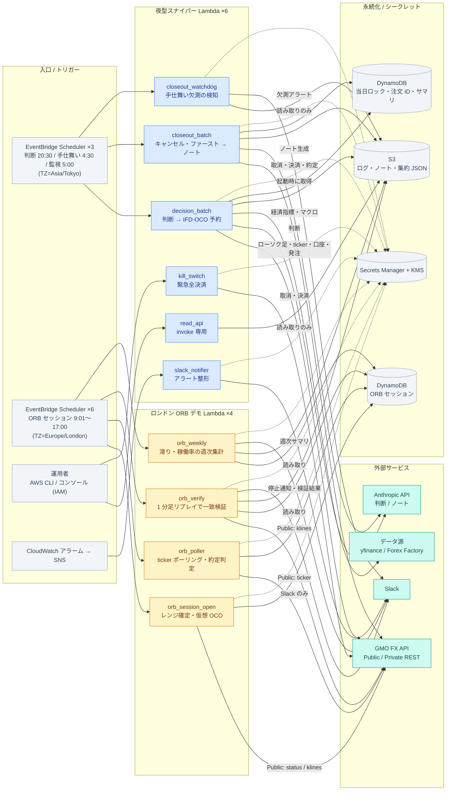

# アーキテクチャ

AI Sniper System の全体構成です。完全サーバーレス・イベント駆動で、すべての処理は定時に起動する AWS Lambda で完結します。
要件の詳細は [system_requirements.md](system_requirements.md)、機能の一覧は [features.md](features.md) にあります。

## 2 つのサブシステム

1 つのリポジトリに、性格の違う 2 つのサブシステムが同居しています。

| | 夜型スナイパー（本線） | ロンドン ORB デモ |
|---|---|---|
| 内容 | 平日夜に LLM が判断し、IFD-OCO を予約。翌朝に手仕舞い | ロンドン時間の Opening Range Breakout を仮想的に執行し、記録する前向きテスト |
| 判断 | LLM + Python の数理ルール | 決定論ルールのみ（LLM なし） |
| 実発注 | あり（two-key interlock で制御） | **なし**（GMO の資格情報を持たないため、構造的に発注できない） |
| タイムゾーン | `Asia/Tokyo` | `Europe/London` |
| Lambda / スケジュール | 6 / 3 | 4 / 6 |
| Terraform モジュール | `modules/serverless_app` | `modules/orb_demo` |

- **依存は一方向です**（ORB → 共通基盤）。夜型のコードは ORB を import しません。この境界は CI で検査しています（[scripts/check_import_boundary.py](../scripts/check_import_boundary.py)）。
- Lambda のデプロイパッケージは両方で共通です。そのため ORB の Lambda にも夜型のコードは含まれます。発注できないことは、コードが無いことではなく、**IAM・環境変数・シークレット・テーブルを分けること**で保証しています。

## 構成図



青は夜型スナイパーの Lambda、橙は ORB デモの Lambda、緑は外部サービス、グレーはトリガー・データ・シークレットです。

## 3 つの経路

- **自動売買（夜型）**: EventBridge Scheduler（JST）が `decision_batch` と `closeout_batch` を起動し、GMO FX API・Anthropic API・データ源を呼び出して、結果を S3 と DynamoDB に保存します。`closeout_watchdog` は手仕舞いの 30 分後に、その朝のログがあるかを確認します。
- **ORB デモ（実発注なし）**: EventBridge Scheduler（London）が ORB の 4 関数を起動します。呼び出すのは GMO の **Public API だけ**で、記録は S3 と専用の DynamoDB テーブルに残します。
- **閲覧・緊急停止**: 運用者が IAM 認証で `read_api`（閲覧）または `kill_switch`（緊急全決済）を invoke します。**どの Lambda も HTTP では公開していません**（[仕様書 §1.6.1](system_requirements.md#161-http-で公開しない)）。
- **ダッシュボード**: Next.js（`dashboard/`）です。Vercel の公開デモは**合成データだけ**で、AWS の資格情報を持たず、Read API にも接続しません。実データは手元専用モード（127.0.0.1 で起動し、Read API を IAM で invoke）でだけ表示します。

## セキュリティ上の設計

- **シークレットは必要な Lambda にだけ渡します**。起動時に 1 回だけ取得します。

  | Lambda | 渡すシークレット |
  |---|---|
  | `decision_batch` / `closeout_batch` | GMO・Anthropic |
  | `kill_switch` | GMO |
  | `slack_notifier` / `closeout_watchdog` / ORB の 4 関数 | Slack Webhook のみ |
  | `read_api` | **なし**（DynamoDB の権限も持たず、S3 の集約 JSON を読むだけ） |

- 図で「読み取り」としている経路には、書き込み権限を与えていません。
- **実発注の two-key interlock**: 発注系の POST は `ALLOW_LIVE_ORDERS=true` **かつ** `TRADING_PHASE` が `2` または `spike` のときだけ送信されます。Terraform モジュールの既定値は安全側（`false` / `"1"`）で、新しい環境は発注しない状態から始まります。環境ごとの設定は `infra/terraform/environments/<環境>/*.auto.tfvars` に宣言し、レビューできる差分として管理します。
- **アラート経路**: Lambda やスケジューラの失敗は CloudWatch アラーム → SNS → `slack_notifier` → Slack の順に届きます。

## スケジュール（全 9 本）

### 夜型スナイパー（TZ=`Asia/Tokyo`）

| ジョブ | cron | 内容 |
|---|---|---|
| decision_batch | `cron(30 20 ? * MON-FRI *)` | 平日 20:30・判断と IFD-OCO の予約 |
| closeout_batch | `cron(30 4 ? * TUE-SAT *)` | 火〜土 4:30・手仕舞い（土曜は週次総括） |
| closeout_watchdog | `cron(0 5 ? * TUE-SAT *)` | 火〜土 5:00・手仕舞いの欠測検知 |

判断・手仕舞い・監視のスケジュールは、それぞれ別の変数で有効・無効を切り替えます。
取引を止めても監視は動き続けるようにするためで、判断を有効にするときは手仕舞いと監視も有効でなければならない、という制約を Terraform の validation で課しています。

### ロンドン ORB デモ（TZ=`Europe/London`）

判定の基準がロンドン時刻で、英国と米国の夏時間は切り替わる週が違うため、JST 固定の cron では近似できません。そのためこのサブシステムだけ `Europe/London` で定義しています。

| ジョブ | cron | 内容 |
|---|---|---|
| session_open | `cron(1 9 ? * MON-FRI *)` | 9:01・レンジ確定と仮想 OCO の設置 |
| poller_open | `cron(2 9 ? * MON-FRI *)` | 9:02・最初の 5 分の観測漏れを埋める |
| poller_intraday | `cron(*/5 9-15 ? * MON-FRI *)` | 9:00〜15:55・5 分ごとの約定判定 |
| poller_eod | `cron(0 16 ? * MON-FRI *)` | 16:00・引けの観測 |
| verify | `cron(30 16 ? * MON-FRI *)` | 16:30・1 分足のリプレイと突き合わせて検証 |
| weekly | `cron(0 17 ? * FRI *)` | 金 17:00・滑りの分布・稼働率・停止条件 |

### 1 日の重なり（UTC 換算・ロンドンが夏時間の期間）

夜型の判断（20:30 JST = 11:30 UTC）は、ORB のポーリング時間帯（8:00〜14:55 UTC）の内側に入ります。
両者は別の Lambda・別のテーブルで、ORB は Public API しか呼ばないため衝突しません。ただし **GMO API への同時アクセスと、Lambda の同時実行数の上限は共有しています**。

```text
UTC  08 ─────── 11:30 ──────── 15:00  15:30   16  ──── 19:30 ─ 20:00
ORB  ├─ 5 分ごとにポーリング（〜14:55）─┤ 引け  検証   週次
夜型              ├──── 保有 約 8 時間 ─────────────────┤ 監視
                判断・発注                              手仕舞い
```

## IaC

- [infra/terraform/modules/serverless_app](../infra/terraform/modules/serverless_app/): 夜型スナイパー
- [infra/terraform/modules/orb_demo](../infra/terraform/modules/orb_demo/): ORB デモ
- [infra/terraform/README.md](../infra/terraform/README.md): 構成とデプロイ手順
