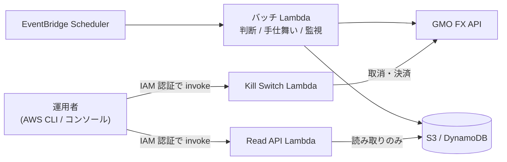
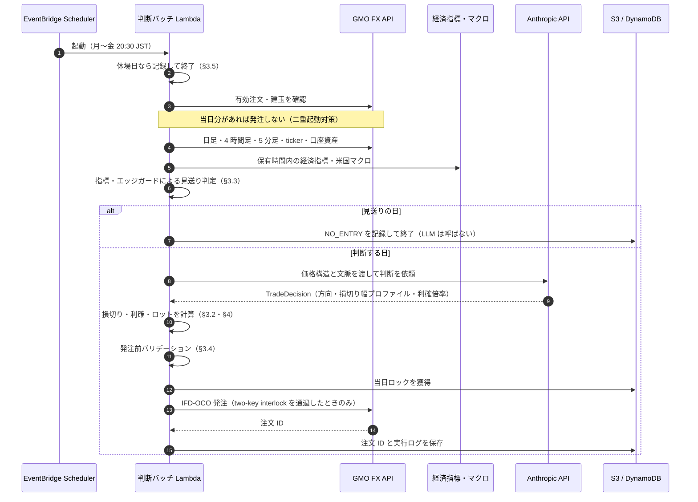
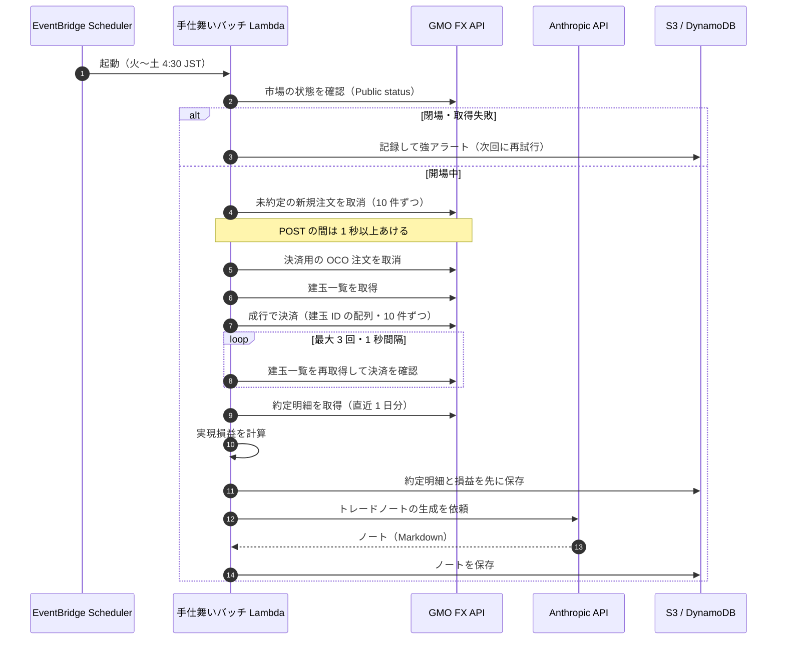

# AI Sniper System 仕様書（公開版）

GMO コイン 外国為替FX API と連携する、完全サーバーレスの予約型 AI トレードシステムの要件定義です。

> [!NOTE]
> 開発で使っている仕様書（Ver. 3.7）を、公開用に要約したものです。変更履歴・運用記録・検証結果の数値・税務関連の記述は除いています。
> 章番号は元の仕様書に合わせているため、コード中の「§3.4」などの参照はこの文書の同じ番号を指します。

**目次**

1. [システム設計方針・インフラ](#1-システム設計方針インフラ)
2. [動作シーケンス](#2-動作シーケンス)
3. [意思決定エンジン](#3-意思決定エンジン)
4. [ロット管理](#4-ロット管理)
5. [法令面の配慮・監査証跡](#5-法令面の配慮監査証跡)
6. [機能要件](#6-機能要件)
7. [非機能要件・安全設計](#7-非機能要件安全設計)
8. [参考リンク](#8-参考リンク)
- [付録 A: TradeDecision JSON スキーマ](#付録-a-tradedecision-json-スキーマ)
- [付録 B: API 実レスポンス記録](#付録-b-api-実レスポンス記録)

---

## 1. システム設計方針・インフラ

### 1.1 サーバーレス化と起動スケジュール
- 常駐プロセス（WebSocket 監視など）は持たず、**定時に起動する AWS Lambda と REST API だけ**で処理を完結させます。
- すべての起動時刻は **JST** で定義し、EventBridge Scheduler にタイムゾーン `Asia/Tokyo` を明示します（UTC への手計算はしません）。

| ジョブ | 起動時刻（JST） | cron | 内容 |
|---|---|---|---|
| 判断バッチ | 月〜金 20:30 | `cron(30 20 ? * MON-FRI *)` | 相場を分析し、IFD-OCO 注文を予約する |
| 手仕舞いバッチ | 火〜土 4:30 | `cron(30 4 ? * TUE-SAT *)` | 未約定注文の取消・建玉の決済・トレードノートの生成（土曜は 1 週間の総括を兼ねる） |
| 手仕舞い監視 | 火〜土 5:00 | `cron(0 5 ? * TUE-SAT *)` | 手仕舞いの記録が無ければアラート（§1.6.2 内） |

- 手仕舞いを 4:30 にしているのは、NY クローズ（夏時間 ≈ 6:00・冬時間 ≈ 7:00 JST）より十分前で、かつ早朝にスプレッドが広がる時間帯より前だからです（§7.3）。
- 実行時間は 1 日あたり数分で、インフラ費用はほぼ無料枠に収まります。LLM の API 料金・スプレッド・API 手数料は別途かかります。

### 1.2 GMO コイン 外国為替FX API への適合
- ベース URL は `https://forex-api.coin.z.com`。Private API は `/private/v1/...`（認証あり）、Public API は `/public/v1/...`（認証なし）です。
- **IFD-OCO 注文（`POST /private/v1/ifoOrder`）を 1 回で送ります。** 新規注文と、利確（指値）・損切り（逆指値）の決済注文を同時に予約できるため、「新規だけ約定して決済注文が無い」状態が生まれません。
- この API では「当日限り」のような日付ベースの有効期限を指定できません。そのため、翌朝の手仕舞いバッチ（§6.2）を**最後の安全弁**として位置づけます。
- 最小注文数量は 100 通貨です。初期の運用は 100 通貨固定とし、損失を小さく抑えます（§4.1）。
- API 経由の注文には約定金額に対する手数料がかかるため、スプレッドと合わせて取引コストとして扱います。

### 1.3 対象通貨ペア
対象は **USD/JPY の 1 ペアのみ**です。複数ペアによるレバレッジの重複を避け、ロット計算を単純に保つためです。
LLM には USD/JPY のデータだけを渡し、エントリーの可否と方向（LONG / SHORT / NO_ENTRY）を判断させます。

### 1.4 GMO FX API エンドポイント定義表
コードでは定数ファイル `backend/src/gmo_fx_endpoints.py` に集約し、パスを直接書くことを禁止します。

| 用途 | HTTP | リクエスト URL パス | 署名パス（§7.2） |
|---|---|---|---|
| IFD-OCO 発注 | POST | `/private/v1/ifoOrder` | `/v1/ifoOrder` |
| 口座資産 | GET | `/private/v1/account/assets` | `/v1/account/assets` |
| 約定履歴 | GET | `/private/v1/executions` | `/v1/executions` |
| 最新約定 | GET | `/private/v1/latestExecutions` | `/v1/latestExecutions` |
| 有効注文 | GET | `/private/v1/activeOrders` | `/v1/activeOrders` |
| 注文取消 | POST | `/private/v1/cancelOrders` | `/v1/cancelOrders` |
| 建玉決済 | POST | `/private/v1/closeOrder` | `/v1/closeOrder` |
| 建玉一覧 | GET | `/private/v1/openPositions` | `/v1/openPositions` |
| ローソク足 | GET | `/public/v1/klines` | （署名不要） |
| 市場の状態 | GET | `/public/v1/status` | （署名不要） |

実装時に確認した注意点:
- FX API には**建玉を一括決済するエンドポイントがありません**。決済は `closeOrder` に建玉 ID と数量の配列（1 回 10 件まで）を渡して行います。
- `cancelOrders` は親注文 ID の配列（1 回 10 件まで）で指定します。
- 詳細は公式ドキュメント（[外国為替FX API](https://api.coin.z.com/fxdocs/)）を参照してください。

### 1.5 永続化
Lambda のファイルシステムは実行ごとに消えるため、状態はすべて外部に保存します。

| 保存先 | 内容 |
|---|---|
| **Amazon S3**（主ストレージ） | 実行ログ（LLM の入出力・API のリクエストとレスポンス・約定結果・トークン消費数）、トレードノート（Markdown）、ダッシュボード用の集約 JSON。バージョニング・暗号化・ライフサイクルを設定 |
| **Amazon DynamoDB** | 当日の実行ロック（`日付 + ジョブ種別`）、判断バッチが発注した注文 ID、直近のサマリ |

書き込みに失敗したら Slack にアラートを送ります。S3 への書き込み成功をもってバッチの正常終了とします。

### 1.6 インフラ構成
ブラウザから GMO の Private API を直接呼ぶ構成は禁止します（署名はサーバー側で生成します。§7.2）。



- **バッチ Lambda**: 判断・手仕舞い・監視。EventBridge Scheduler から起動します。
- **Read API Lambda**: ダッシュボード用に、S3 の集約 JSON と DynamoDB のサマリを返します。
- **Kill Switch Lambda**: 残っている注文の取消と、全建玉の成行決済を行う緊急停止用の関数です。手仕舞いバッチと同時に動いても安全なように作り、建玉が無いときは何もせず正常終了します。

#### 1.6.1 HTTP で公開しない
**どの Lambda も HTTP で公開しません。** 呼び出し経路は EventBridge Scheduler と、IAM 認証の `lambda:InvokeFunction` だけです。
Lambda Function URL・API Gateway・CloudFront による公開は Terraform に定義せず、CI（`scripts/check_no_public_endpoints.py`）で検出したらビルドを失敗させます。

理由は次の 2 つです。

1. **静的なフロントエンドに長期の秘密を置けない。** SPA から Bearer トークンを送る方式では、トークンがバンドルかブラウザのストレージに残り、実質的に公開された値になります。Kill Switch は全建玉を決済できる（＝資金を動かせる）ため、この強度の認証で公開してよい対象ではありません。
2. **攻撃面を増やさない。** 利用者は 1 人であり、公開して得られる利便性より、資金を動かす API をインターネットに晒すリスクの方が大きいと判断しました。

認証は IAM（AWS SSO のセッション）に任せ、アプリケーション層には共有の秘密を持たせません。
Cognito や IAM 認証付きの Function URL など、公開したまま安全にする方法もあります。採用しないのは、単一利用者という前提に対して過大だからです。見直す条件は §1.6.3 に定めます。

#### 1.6.2 緊急時の決済手段
上から順に試します。

| 順 | 手段 | 外出先から |
|---|---|---|
| 1 | 予定どおりの手仕舞いバッチ（火〜土 4:30） | — |
| 2 | 手仕舞いバッチまたは Kill Switch を IAM 認証で invoke（CLI・AWS コンソール） | スマートフォンのブラウザから可 |
| 3 | GMO の Web サイト・アプリから手動で決済 | 可（最終手段） |

**手仕舞いの欠測監視**: 手仕舞いの 30 分後（5:00）に、その朝の手仕舞いログが S3 にあるかを確認し、無ければ Slack に強いアラートを送ります。
Scheduler が止まっていると、Lambda のエラーも失敗イベントも出ないため、既存の監視では気づけません。そのため判定は「S3 に成果物があるか」で行います。
監視用のスケジュールは取引用のスケジュールと別の変数で有効・無効を管理し、取引を止めても監視は止まらないようにしています。

#### 1.6.3 見直しの条件
§1.6.1 の判断は、単一利用者・100 通貨固定・夜間のみ保有という現在の前提に基づきます。次のいずれかに当てはまったら見直します。

- ロット上限の引き上げ、または 100 通貨固定の解除
- 複数の通貨ペア・戦略への拡張、または保有時間の延長
- 外出先からの緊急停止が運用上の要件になったとき
- 利用者が 2 人以上になったとき

---

## 2. 動作シーケンス

### 2.1 判断バッチ（平日 20:30 JST）



夜間は GMO のサーバーが指値・逆指値を監視し、約定と決済を処理します。この間、こちらのインフラは何も動いていません。

### 2.2 手仕舞いバッチ（翌 4:30 JST・キャンセル・ファースト）



順序（新規注文の取消 → 決済注文の取消 → 成行決済）は逆にしません。理由は §6.2 にまとめています。

---

## 3. 意思決定エンジン
Python が計算した価格構造（ピボット・ATR）を土台に、LLM には経済指標やセンチメントなどの文脈の解釈を任せるハイブリッド構成です。
**価格と数量の決定は Python が持ち、LLM には離散的な選択肢しか渡しません。**

### 3.1 ピボット・ポイント
前日の高値（H）・安値（L）・終値（C）から、多くの参加者が意識する支持・抵抗のラインを計算します。

| ライン | 式 |
|---|---|
| P（基準） | `(H + L + C) / 3` |
| R1 / S1 | `2P − L` / `2P − H` |
| R2 / S2 | `P + (H − L)` / `P − (H − L)` |

- 入力には**直近の確定した取引日**の日足を使います。単純な「今日 − 1 日」ではありません（月曜は金曜の足を使う）。最大 7 日遡って探し、確定していることをタイムスタンプで検証します。確定していなければ NO_ENTRY とします。
- 判断を 20:30 にしているのは、GMO のスプレッドを時間帯別に測った結果、早朝（概ね 5:00〜8:00 JST）に大きく広がり、夜間は狭いことが分かったためです。

### 3.2 ATR・損切り・利確
- 直近 14 日の日足 ATR（ATR14）を Python で計算します。
- 損切り・利確の単位には、ATR14 を**保有時間に合わせて換算した値**を使います。

  ```text
  ATR_h = ATR14 × √(HOLD_HOURS / 24)     # HOLD_HOURS の既定は 8（20:30 → 翌 4:30）
  ```

  日足の ATR をそのまま使うと、8 時間の保有で実際に動く幅に対して損切り幅が大きすぎ、利確に届かない構造になるためです。

- **損切り（Python が決定）**: LLM は `sl_profile`（`standard` または `wide`）だけを選び、Python が倍率に変換します（`standard` → 0.7、`wide` → 0.8。許容範囲は 0.6〜1.0 でクランプ）。

  ```text
  LONG : stop_loss = entry − ATR_h × atr_multiplier
  SHORT: stop_loss = entry + ATR_h × atr_multiplier
  ```

- **利確（Python が決定）**: LLM は `rr_target`（1.0〜1.5・既定 1.0）だけを選びます。

  ```text
  LONG : take_profit = entry + rr_target × |entry − stop_loss|
  SHORT: take_profit = entry − rr_target × |entry − stop_loss|
  ```

- **tick への丸め**: 損切り・利確とも「entry から遠ざかる向き」に丸めます（損切りは LONG で切り下げ・SHORT で切り上げ、利確はその逆）。こうすると、ロット計算に使う損切り幅と発注価格が常に一致し、R:R が丸めで 1.0 を下回ることもありません。
- **4 時間足**はピボット・ATR には使わず、直近 6 本（24 時間分）を LLM に「日中の流れ」の文脈として渡します。

### 3.3 入力データ
価格データだけを LLM に渡すと、ピボットや ATR の追認にとどまり、判断に価値が加わりません。そこで次の情報も渡します。

**経済指標カレンダー（必須）**
- 保有時間（判断日 20:30 〜 翌 4:30 JST、両端を含む）に発表される USD/JPY の高インパクト指標を、名前と発表日時つきで取得します。取得元は設定で切り替えられます（既定は Forex Factory）。
- 発注は常に 20:30 で、約定する時刻は制御できません。そのため「発表の前後を避ける」ルールは発注前の検査ではなく、次の 2 段で扱います。
  1. **見送り（LLM を呼ぶ前に判定）**: 高インパクト指標が JST 20:30〜23:00、または米国東部時間 7:30〜10:00 にある日は NO_ENTRY とします。雇用統計や CPI などがこれに当たります。
  2. **LLM の判断材料**: それ以外の時間帯の指標は、日時つきでプロンプトに載せて判断を任せます。
- **取得に失敗したら NO_ENTRY** にします。空の応答や、取得した期間が保有時間と重ならない場合も「指標なし」とはみなしません。

**エッジガード（LLM を呼ぶ前に判定）**: 次のいずれかに当てはまる日は見送ります。閾値は環境変数で持ちます。

| ガード | 条件 |
|---|---|
| G1 ワイドスプレッド | 判断時のスプレッドが `MAX_DECISION_SPREAD_PIPS` 以上 |
| G2 高ボラティリティ | ATR14 が `MAX_ATR_DAY_SKIP_PIPS` 以上 |
| G3 値動きなし | 当日の始値からの変化が `MIN_SESSION_MOMENTUM_ATR × ATR14` 未満 |

**米国マクロ（補助）**: 米 10 年債利回り・S&P 500 先物・日経 225 先物の直近値と前日比を 1 行で渡します。取得に失敗した場合は行を省いて続行します（NO_ENTRY にはしません）。

**当日の値動き**: 当日 6:00 JST から判断時刻までの 5 分足から、始値・高値・安値を計算して渡します。15:00 を境に東京時間と欧州時間に分け、欧州時間が東京時間のレンジを抜けたかどうかも判断材料にします。判断時刻より後の足は使いません。

### 3.4 発注前バリデーション
Python で計算し終えた最終価格に対して、発注の直前に次をすべて検査します。一つでも満たさなければ**発注せず**、理由を記録します。

| 検査 | 条件 |
|---|---|
| 価格の並び | LONG: `SL < Entry < TP` / SHORT: `TP < Entry < SL` |
| R:R の下限 | `\|TP − Entry\| ≥ MIN_RR_RATIO × \|Entry − SL\|`（計算上は常に満たすが、防御として残す） |
| tick への丸め | USD/JPY の最小刻みに合っていること |
| 現在値からの乖離（上限） | `\|Entry − 現在の仲値\| ≤ MAX_ENTRY_DISTANCE_ATR × ATR14`（既定 0.3） |
| 現在値からの乖離（下限） | GMO の最小距離の制約を満たすこと |
| ロット | 100 通貨以上・100 通貨単位 |

### 3.5 休場日
- 休場日（元日・クリスマスなど）は `config/market_holidays.json` で管理し、判断バッチは休場日なら発注も LLM の呼び出しもせずに終了します。
- 休場日でもスケジューラは起動するため、この早期終了で誤発注を防ぎます。

---

## 4. ロット管理

### 4.1 ロットの計算
口座の純資産から、1 トレードの許容リスク（既定 1%）に見合う数量を計算します。

```text
L_max           = A_equity × RISK_PERCENT          # 1 トレードの最大許容損失（円）
D_stoploss_pips = |entry − stop_loss| / 0.01
V_raw           = L_max / (D_stoploss_pips × 0.01)
V_rounded       = floor(V_raw / 100) × 100         # 最小単位 100 通貨で切り捨て
```

`MVP_MODE=true` のときは発注数量を **100 通貨に固定**します。それでも上の計算は毎回行い、「固定しなければ何通貨だったか」をログに残します。

### 4.2 レバレッジ上限と証拠金チェック

```text
V_leverage_cap = floor((A_equity × MAX_LEVERAGE) / (P_current × 100)) × 100
V_safe         = min(V_rounded, V_leverage_cap)
```

最後に、必要証拠金が発注可能額以下であることを確かめます。満たさなければ NO_ENTRY とし、ロットを減らして再試行することはしません。

**主な環境変数**（すべて `.env.example` に記載）

| 変数 | 既定値 | 意味 |
|---|---|---|
| `RISK_PERCENT` | `0.01` | 1 トレードの許容リスク |
| `MAX_LEVERAGE` | `10` | レバレッジの上限 |
| `MIN_RR_RATIO` | `1.0` | R:R の下限 |
| `MVP_MODE` | `true` | 100 通貨に固定するか |
| `HOLD_HOURS` | `8` | 保有時間（ATR_h の換算に使用） |
| `RR_TARGET_DEFAULT` | `1.0` | `rr_target` が未指定・範囲外のときの値 |
| `MAX_ENTRY_DISTANCE_ATR` | `0.3` | 現在値からの乖離の上限（ATR14 に対する倍率） |
| `ALLOW_LIVE_ORDERS` / `TRADING_PHASE` | `false` / `1` | 実発注の two-key interlock（§7.1） |

---

## 5. 法令面の配慮・監査証跡

### 5.1 不公正な取引につながる不具合の防止
- 判断は 1 日 1 回、発注は IFD-OCO を 1 回だけにし、注文を繰り返し出すループが構造上起きないようにします。見せ板とみなされるような挙動を、バグであっても起こさないためです。
- API の呼び出し頻度は GMO の制限（POST 1 回/秒・GET 6 回/秒）に従います。

### 5.2 実行ログの保存
毎回の実行について、LLM の入出力、発注のリクエストとレスポンス、約定結果、トレードノート、タイムスタンプ、LLM のトークン消費数を JSON で S3 に保存します。
取引と運用コストを後から客観的に検証できるようにするためです。

---

## 6. 機能要件

### 6.1 判断・IFD-OCO 予約（平日 20:30 JST）
- **休場日・二重起動**: 休場日は終了します（§3.5）。発注前に有効注文と建玉を確認し、すでにあれば発注しません。
- **データ収集**: §3 のデータを取得します。API の負荷を抑えるため、呼び出しの間に 1 秒以上あけます。
- **見送り判定**: 指標による見送りとエッジガード（§3.3）を、LLM を呼ぶ前に評価します。経済指標の取得に失敗して見送った日は Slack に 1 通だけ通知します。
- **LLM の呼び出し**: Anthropic API の構造化出力（Pydantic スキーマ）で、付録 A の TradeDecision を受け取ります。
- **Python による補完**: 損切り・利確（§3.2）とロット（§4）を計算し、発注前バリデーション（§3.4）を通ったときだけ発注します。
- **当日ロックの扱い**（DynamoDB）:

  | 発注の結果 | ロック |
  |---|---|
  | 成功 | 保持し、注文 ID を書き込む |
  | スタブ（実発注が無効） | 保持する（本番と同じ挙動を確かめるため） |
  | 拒否が確実（HTTP 4xx・ボディの status がエラー） | 解放し、当日の再実行を許す |
  | 結果が不明（5xx・タイムアウト・通信エラー） | 保持する（約定した可能性を否定できないため） |

  ロックの解放に失敗したときは、「条件を満たさないので解放しなかった」（ロックが無い・実際の注文 ID が記録済み）と「障害で解放できなかった」（権限不足・DynamoDB の障害）を区別し、障害のときだけ Slack に通知します。ロックが残ると、その日の再実行ができなくなるためです。
- **判断済みの記録**（DynamoDB）: 見送りの日は当日ロックを取らないため、同じ日にもう一度起動すると LLM を呼び直し、今度は発注まで進むおそれがあります。そこで、その日の結論（見送りを含む）が出たら当日ロックとは別のレコードに記録し、2 回目の起動は判断をやり直さずに終了します。
  - LLM の呼び出しに失敗して安全側の見送りに倒した場合や、経済指標を取得できずに見送った場合など、やり直せば判断できる失敗は記録しません。
  - 記録の書き込みに失敗しても判断結果は変えません。読み取りに失敗したときは判断を止めません（発注には当日ロックが別に必要です）。
  - 判断を意図的にやり直したいときは、起動時のパラメータでこの確認だけを飛ばせます。

- **実発注の条件**: `ALLOW_LIVE_ORDERS=true` **かつ** `TRADING_PHASE` が `2` または `spike` のときだけ実際に送信します。それ以外はスタブの応答を返します（§7.1）。

### 6.2 手仕舞い・トレードノート（翌 4:30 JST）
**キャンセル・ファーストの手順**

1. **市場の状態を確認**: `GET /public/v1/status` の `data.status` が `OPEN` のときだけ続行します。`CLOSE`・`MAINTENANCE`・不明な値・取得失敗はすべて閉場として扱います。
2. **未約定の新規注文を取消**: 有効注文から親注文 ID を集め、10 件ずつ取り消します。
3. **決済用の OCO 注文を取消**: すでに約定した建玉の利確・損切り注文を取り消します。
4. **成行で決済**: 建玉一覧を取得し、建玉 ID と数量の配列で 10 件ずつ決済します。
5. **決済の確認**: 建玉一覧を最大 3 回（1 秒間隔）取り直し、差分で決済できたかを確認します。

すべての POST の間は 1 秒以上あけます。

**順序を守る理由**: 決済注文を残したまま決済できるかどうかは実際に試しており、少なくとも単純なケースでは決済できました。それでもこの順序を守るのは次の理由からです。
- 決済の段階で扱う状態が単純になる
- 利確・損切りの約定と成行決済がぶつかる競合を避けられる
- 確認できていない条件（分割決済・複数建玉など）で拒否されると、損切り注文を消した建玉が翌朝まで無防備に残る

**失敗時の扱い**
- `closeOrder` の成功は「受付」であって約定ではありません。そのため決済の確認は必ず建玉一覧の差分で行います。
- `closeOrder` を再送するのは、**API が明確に拒否したとき（未受付が確実なとき）だけ**です。タイムアウトや接続断は受け付けられた可能性があるため再送しません。
- 決済できなかった建玉は損切りなしで残るため、建玉 ID を明記した強いアラートを Slack に送ります。
- 決済の確認に、建玉一覧と有効注文一覧を突き合わせることはしません。2 つの一覧は同じ時点の状態を返すとは限らず、決済済みの建玉が残っているように見えることがあるためです。

**約定明細の取得**
- 約定を日付の範囲で取得する API はありません。`latestExecutions` は直近 1 日分・最大 100 件、`executions` は注文 ID か約定 ID を指定して取得します。
- IFD-OCO の決済約定は、新規注文とは別の注文 ID になります。新規と決済の両方を取れるのは `latestExecutions` だけです。
- 明細は翌日には取り直せないため、読み取り専用の GET に限り、1 回の実行の中でリトライします。
- 土曜の週次総括では、平日の手仕舞いで S3 に保存した明細を集計します。
- **HTTP 200 でもボディの status がエラーなら例外にします。** これを見落とすと、API のエラーが「約定なし」に見えてしまいます。実際にこれで、LLM が事実と反対のノートを書いたことがありました。
- 「取得できなかった」と「約定が無かった」を区別し、取得できなかったときはノートを作りません。
- **損益は Python で計算**し、確定値として LLM に渡します（`lossGain` + `fee` + `settledSwap`）。

**トレードノート**
- 前夜の判断と約定結果を比べた振り返りを、LLM が Markdown で書きます。ノートは運用の記録であり、戦略のパラメータを自動で変更することはしません。
- **証跡は LLM より先に保存します。** ノートは書き直せますが、約定明細は取り直せないからです。いったん保存してから、ノートの生成後に上書きします。
- LLM の呼び出しには明示的なタイムアウトを設定します（SDK の既定値は Lambda の実行時間の上限より長いため）。
- 応答の `stop_reason` を検査し、出力の上限に達して途中で切れた応答を正常とみなしません。

### 6.3 ダッシュボード
- ダッシュボードは運用に必須の機能ではありません。日々の確認は、S3 のログやノートの取得、または Read API Lambda の invoke で行います。
- `dashboard/`（Next.js）に当日・履歴・日次詳細の 3 画面を実装しています。
- 公開しているのは**合成データだけのデモ**（Vercel）です。AWS の資格情報を持たず、Read API にも接続しません。
- 実データは自分の PC でだけ表示します。Next.js のサーバー側が IAM 認証で Read API を invoke し、127.0.0.1 以外で起動したときは起動を拒否します。HTTP の公開口は作らず（§1.6.1）、ブラウザに秘密を置かず、Kill Switch はブラウザから実行しません。

---

## 7. 非機能要件・安全設計

### 7.1 2 段階の開発プロセス
GMO の FX API にはテスト環境（サンドボックス）が無いため、2 段階で検証します。

| フェーズ | 内容 | 完了条件 |
|---|---|---|
| Phase 1（モック） | 発注系 POST をスタブにして、注文・取消・ノート生成の流れを通す | 1 週間連続でエラーなし |
| Phase 2（実取引） | 最小単位の 100 通貨で実際に発注する。Kill Switch を用意する | 1 週間の結合テスト |

- **two-key interlock**: 実際の発注は、独立した 2 つの条件（`ALLOW_LIVE_ORDERS=true` **かつ** `TRADING_PHASE` が `2` または `spike`）を両方満たすときだけ許可します。既定値はどちらも安全側です。
- 必須のテストケース: 月曜の起動（前日の足＝金曜）、金曜の建玉を土曜に手仕舞い、休場日の起動、指標による見送り、署名パスの一致。
- ローカルでは `MOCK_MODE=True python scripts/run_local_simulation.py --days 7` で Phase 1 の完了条件を確認できます。

### 7.2 認証・署名・シークレット
- **署名パスの非対称**: リクエスト URL は `/private/v1/...` ですが、HMAC-SHA256 の署名対象は `/private` を含まない `/v1/...` です。署名関数は URL パスと署名パスを別の引数で受け取り、一致を CI のテストで保証します。
- `API-TIMESTAMP` は送信の直前に取得して署名します。HTTP 401 が返ったら 1 回だけ署名し直し、1 秒以上待ってから再送します。
- メンテナンス中などで API が使えない場合は、Slack にアラートを送ります。
- API キーなどは **AWS Secrets Manager** に保存し、1 回の実行につき 1 回だけ取得してメモリに保持します。ローカル開発でのみ `.env` を使います（Git には含めません）。
- GMO の API キーの権限は、外国為替FX の「参照」と「注文」に限定します。

### 7.3 取引時間・夏時間・市場の状態
- 手仕舞いはすべての営業日で 4:30 JST の 1 本にしています。月〜金に建てた建玉を翌営業日の 4:30 に決済するため、保有時間は常に約 8 時間です（`HOLD_HOURS` と一致）。
- NY クローズは夏時間と冬時間で 1 時間ずれますが、4:30 はどちらでも終了の 1.5〜2.5 時間前で、スプレッドが広がる時間帯の前です。
- 市場が開いているかどうかは **`GET /public/v1/status` の `data.status` だけで判定**します。閉場中でも参照系の GET（建玉一覧など）は正常に応答するため、その成否では閉場を検知できません。
- レスポンスの外側の `status`（API の成否）と、`data.status`（市場の状態）は同じ名前の別物です。

### 7.4 戦略の評価方針
- 100 通貨固定の運用は、収益を出すことではなく「**この戦略に優位性があるか**」を確かめるためのものです。
- 主な指標は約定 1 回あたりの期待値（R 単位）です。LLM を使わない固定ルール（凍結したベースライン）と、同じ日・同じ条件で比べた差で判定します。単独の損益は 1 回ごとのばらつきが大きく、少ない件数では判断できないためです。
- ベースライン・目標値・判断と手仕舞いの時刻は、バックテストで最適化する対象にしません（過学習を避けるため）。
- プロンプトや見送り条件を変えたら、変更前と変更後の結果を混ぜずに分けて集計します。

---

## 8. 参考リンク
- [外国為替FX API ドキュメント（GMO コイン 公式）](https://api.coin.z.com/fxdocs/)
- [外国為替FX API 製品ページ](https://coin.z.com/jp/corp/product/info/fx/api/)
- [Anthropic API ドキュメント](https://docs.anthropic.com/)

---

## 付録 A: TradeDecision JSON スキーマ

LLM の出力は、Anthropic API の構造化出力（`messages.parse` + Pydantic）でこの形に固定します。
**`stop_loss` と `take_profit` は LLM が出力しません。** Python が §3.2 の式で計算します。

### A.1 LLM の出力

```json
{
  "sentiment_summary": "指標・ニュースの要約（任意）",
  "rationale": "判断理由（200 文字以内）",
  "direction": "LONG | SHORT | NO_ENTRY",
  "referenced_pivot_level": "R1 | S1 | P | R2 | S2 | NONE",
  "order_type": "LIMIT | STOP",
  "entry_price": 150.123,
  "sl_profile": "standard",
  "rr_target": 1.0,
  "execution_required": false
}
```

フィールドは「分析 → 理由 → 結論 → 詳細」の順に並べています。モデルが理由を書いてから方向を決めるようにするためです。

| フィールド | 型 | 必須 | 説明 |
|---|---|---|---|
| `sentiment_summary` | string | - | 経済指標・センチメントの要約 |
| `rationale` | string | ○ | 判断理由（ログ・ノート用） |
| `direction` | enum | ○ | 方向。`NO_ENTRY` なら発注しない |
| `referenced_pivot_level` | enum | △ | 参照したピボットのライン（記録用） |
| `order_type` | enum | △ | `LIMIT`（現在値付近の押し目・戻り。既定）または `STOP`（逆指値） |
| `entry_price` | number | △ | エントリー価格。現在値から ±0.1×ATR14 以内が基本（上限は §3.4） |
| `sl_profile` | enum | ○ | 損切り幅。`standard`（倍率 0.7）または `wide`（0.8） |
| `rr_target` | number | △ | 利確の R:R。1.0〜1.5（範囲外はクランプ） |
| `execution_required` | bool | ○ | `true` かつ方向が `NO_ENTRY` 以外のときだけ発注に進む |

### A.2 Python が付け加える値

| フィールド | 説明 |
|---|---|
| `ATR_h` | `ATR14 × √(HOLD_HOURS/24)` |
| `atr_multiplier` | `sl_profile` から変換した倍率 |
| `stop_loss` / `take_profit` | §3.2 の式で計算し、entry から遠ざかる向きに丸めた価格 |
| `D_stoploss_pips` | `\|entry − stop_loss\| / 0.01` |
| `V_raw` / `V_safe` | §4 のロット計算の結果 |

**発注までの流れ**: 発注しない判断ならノートに理由を記録して終了します。発注する判断なら、損切り・利確・ロットを計算し、§3.4 の検査を通ったときだけ `ifoOrder` を送り、注文 ID を DynamoDB に保存します。

---

## 付録 B: API 実レスポンス記録
GMO FX API の実際のレスポンス（フィールド名・型・値の例）と、公式ドキュメントとの対応は `docs/spikes/` に記録しています。
公式ドキュメントの引用や実際の口座の応答を含むため、公開版には含めていません。記録したテーマの概要は [docs/spikes/README.md](spikes/README.md) にあります。
